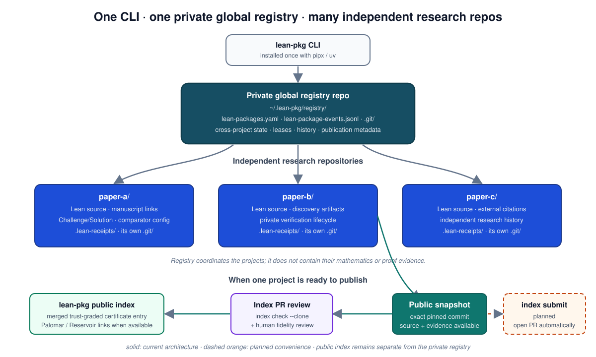

<p align="center">
  
</p>

<h1 align="center">lean-pkg</h1>

<p align="center">
  <strong><em>Prove it. Then prove you proved it.</em></strong><br>
  A registry and trust gate for Lean 4 formalization packages: know which packages exist, who holds each one, and what evidence binds it to a verified commit, before anything becomes public.
</p>

<p align="center">
  <a href="https://github.com/lean-pkg/lean-pkg/actions/workflows/ci.yml"></a>
  <a href="LICENSE"></a>
  <a href="https://doi.org/10.5281/zenodo.23272098"></a>
  
  <a href="https://lean-pkg.github.io/lean-pkg/"></a>
  <a href="llms.txt"></a>
</p>

---

## Why lean-pkg

*A green build is a claim. A receipt is evidence.*

A Lean project that builds with zero `sorry` is not yet a verified theorem.
The statement may have drifted from the paper's claim, the check ran in the
same kernel that elaborated the proof, and "CI was green" is a status word
nobody can re-derive. `lean-pkg` requires two receipts before a package can
go public: a build-and-axioms receipt bound to one commit, and a
**comparator** receipt in which trusted statements are checked against
untrusted proofs and replayed in an independent kernel. At promotion time it
re-derives both from bytes.

### Research loop: discover, formalize, verify

Research mathematics is rarely linear. A symbolic computation may suggest a
formula; Lean may expose a missing hypothesis; the manuscript changes; the
formalization changes with it. `lean-pkg` is designed to keep the verification
state attached to exact commits while that loop remains private.

The trust boundary is deliberately asymmetric:

- Python, SymPy, Sage, Mathematica, numerical experiments, or hand calculations
  may **discover** a candidate claim;
- Lean states and proves the mathematical claim;
- `lean-pkg` records which exact source and evidence were actually verified.

A computational discovery is therefore provenance, not proof. If the final Lean
theorem no longer depends on trusting the computation that suggested it, the
certificate rests on the Lean proof, not on the exploratory tool.

As formal libraries mature, a result that was initially conditional can be
re-certified with fewer external dependencies. The roadmap treats that
progression as certificate lineage rather than overwriting history.

**Develop privately. Discover freely. Verify explicitly. Publish reproducibly.**

## Who is this for

- **A research group** formalizing its own papers: run the private lifecycle
  (register, claim, gate, promote), mostly through agents, with a human
  reading each dry run.
- **A mathematician** asking "is this already verified in Lean?": read the
  field index, with hypotheses and paper correspondence, keyed to Palomar ids.
- **An LLM agent** proving something: fetch [llms.txt](llms.txt) and the index
  first; import instead of re-deriving.
- **A contributor**: send code to the tool, or an index entry for a result
  you verified.

## Not Palomar, not Mathlib

Public verified results are registered in [Palomar](https://palomar-registry.org/),
which archives them and assigns stable ids. Every package depends on
[Mathlib](https://github.com/leanprover-community/mathlib4). Public packages
are indexed by [Reservoir](https://reservoir.lean-lang.org/), automatically
(no registration step), which checks that they build but not what they prove;
search it before building anything new. `lean-pkg`
covers what those leave out: the months *before* a result is public, and a
field-curated index *after*. A package that passes its comparator tier is
already in the shape Palomar accepts. The full comparison is in
[Motivation](docs/motivation.md#lean-pkg-palomar-reservoir-and-mathlib) and the
[FAQ](docs/faq.md).

## In sixty seconds

Install the CLI once, then use one **shared private registry** to coordinate
many independent Lean/Git research repositories.

<p align="center">
  
</p>

```text
~/.lean-pkg/registry/          # recommended shared coordination repo
  .git/
  lean-packages.yaml
  lean-package-events.jsonl

~/src/
  paper-a/                     # its own Git repo and Lean project
  paper-b/                     # another independent Git repo
  paper-c/
```

Today, bootstrap the shared registry explicitly:

```bash
pipx install git+https://github.com/lean-pkg/lean-pkg.git

mkdir -p ~/.lean-pkg/registry
git -C ~/.lean-pkg/registry init
lean-pkg --registry ~/.lean-pkg/registry/lean-packages.yaml init
git -C ~/.lean-pkg/registry add lean-packages.yaml lean-package-events.jsonl
git -C ~/.lean-pkg/registry commit -m "registry: initialize lean-pkg"

# ~/.lean-pkg/registry is the default registry location: no LEAN_PKG_REGISTRY needed

# placeholders: replace you/my-proof with your repository and src/my-proof with
# the path of your checkout under $HOME (here ~/src/my-proof)
lean-pkg register my-proof --repo git@github.com:you/my-proof.git --path src/my-proof
lean-pkg claim my-proof --workspace laptop --agent you --reason "first receipt"
lean-pkg renew my-proof --agent you            # past 24 h: renew before the lease lapses (`lean-pkg leases`)
cd ~/src/my-proof && lake exe cache get
# on your own machine, allow this host; without it the run refuses by design
COMPARATOR_RECEIPT_ALLOWED_HOSTS="$(hostname)" comparator-receipt
lean-pkg comparator my-proof --check --receipt .lean-receipts/<c12>-comparator.json
lean-pkg promote my-proof                      # dry run: the checklist says what is missing
```

No Lean project yet? [Getting started, step 1](docs/getting-started.md#start-from-scratch)
makes a minimal Challenge/Solution project with a complete `comparator.json`,
ready for `comparator-receipt`.

`my-proof` is the package name given to `register`: every later command that
takes `NAME` (`claim`, `comparator`, `next`, `promote`, ...) takes that name,
never a path. `--path` is relative to `$HOME`; if the checkout is somewhere
else, `lean-pkg update my-proof --path DIR --reason "checkout moved"` records
the real one.

The registry repository is the cross-project coordination history; each research
repository keeps its own mathematics and committed `.lean-receipts/` evidence.
Keep the shared registry private unless you intentionally want to expose
pre-publication project names, paths, notes, and status history.

A future one-command bootstrap such as `lean-pkg init --global` is proposed in
the [roadmap](ROADMAP.md); it is not implemented yet.

## What it does

*register → claim → gate → comparator → publish → index*

| Step | Commands | What it gives you |
|---|---|---|
| register | `lean-pkg register`, `update` | one record per package; `register` is the only way in |
| claim | `lean-pkg claim`, `renew`, `release`, `leases` | a lease (24 h by default; `--contact` names the session behind it), so two people or agents never work on one package unknowingly |
| gate | `lean-pkg gate` | the lower-tier receipt (build, no `sorry`, axioms) moves the package to `verified-private` |
| comparator | `comparator-receipt`, `lean-pkg comparator` | the comparator receipt: trusted statements against untrusted proofs, replayed in a second kernel |
| publish | `lean-pkg publish --dry-run`, `promote` | one read-only checklist to listed, then the one-way flip to public |
| index | `lean-pkg index add`, `index check --clone` | a [field index](docs/index-catalog.md) entry whose trust (`lower-tier`, `comparator`, `palomar`) is computed from the evidence, never typed |

Not sure what comes next for a package? `lean-pkg next NAME` prints the single recommended command and why; agents get the same answer with `--json`.

Something went wrong? `lean-pkg report --command "..."` drafts a bug report in this repository's issue format with every private path and address redacted; `--yes` files it.

Safety nets, before anything is public:

- `lean-pkg public-safety NAME` scans the tree and the whole git history for
  private strings; `promote` refuses while blocking hits remain.
- `lean-pkg release NAME --fresh-repo DIR` (or `--adopt-repo DIR`) gives a
  package incubated beside a paper a fresh public history; see
  [Publishing a package incubated beside private work](docs/receipts.md#publishing-a-package-incubated-beside-private-work).
- `lean-pkg comparator host-check` says whether this machine can produce
  comparator receipts at all, before a long run.
- `lean-pkg audit` reports expired leases, receipt drift and GitHub
  visibility mismatches.

Two files live in each package repository. `claims.yaml` (schema `claims/1`)
names the results someone might reuse; `lean-pkg claims sync`, `claims list`
and `claims check` cache and validate them, and `lean-pkg search` searches them
with the index and public sources ([Prior-art search](docs/prior-art.md)).
`formalization.yaml` is the mathlib-initiative self-report Palomar reads;
`lean-pkg formalization NAME` renders it from the registry and the receipts
([formalization.yaml](docs/formalization.md)).

After the flip:

- **Reservoir:** `lean-pkg reservoir check NAME` checks the listing criteria
  before you wait for Reservoir to list the package.
- **Palomar:** `lean-pkg palomar prepare NAME` builds the submission bundle
  locally; nothing is sent.
- **Zenodo:** archive each GitHub release for a DOI and record it with
  `lean-pkg record NAME doi-minted`; lean-pkg itself is archived under
  [10.5281/zenodo.23272098](https://doi.org/10.5281/zenodo.23272098).

## Learn the workflow

| If you are | Start with |
|---|---|
| new to Lean | [Start here](docs/newcomers.md): a one-to-two-week reading path (Functional Programming in Lean, Chapter 1, and the Math 7800 lectures), then the sample |
| ready to try it | [Sample workflow](docs/sample-workflow.md): a real package, register to promotion dry run, every command and output |
| looking something up | [How to](docs/how-to.md) · [CLI reference](docs/cli.md) · [Receipts and trust](docs/receipts.md) · [The comparator tier](docs/comparator.md) · [formalization.yaml](docs/formalization.md) · [The index](docs/index-catalog.md) · [Prior-art search](docs/prior-art.md) · [Lifecycle](docs/lifecycle.md) |
| an agent | [llms.txt](llms.txt) · [AGENTS.md](AGENTS.md) · [Using lean-pkg with agents](docs/agents.md) · [Agent skills](skills/README.md) |
| stuck | [FAQ](docs/faq.md) |

Documentation site: <https://lean-pkg.github.io/lean-pkg/>.

## For collaborators

Joining someone else's package? Accept the GitHub invitations, log in with
`gh auth login`, clone this repository, and run
`bash scripts/bootstrap-collaborator.sh OWNER/PACKAGE`: it checks the machine
and your access, installs lean-pkg, clones the package and sets up your own
committed registry. Then follow
[Add the comparator tier to an existing package](docs/existing-package-comparator.md)
step by step. Trying the tool cold, from the documentation alone? Record what
happened with the [stranger test](docs/stranger-test.md) template.

## Requirements

Python 3.11+ and PyYAML. `git` for anything that reads a repository; `gh`,
authenticated, for `promote` and `audit`. `comparator-receipt` needs Linux,
`elan`, `go`, `cargo`, `jq` and `bwrap` (bubblewrap, the toolchain
mechanism's sandbox); `lean-pkg comparator host-check` says whether this
machine can produce comparator receipts, and with which mechanism. With the
toolchain mechanism (Lean v4.35.0-rc2 or later, what Palomar runs) a first
run takes seconds once the Mathlib cache is in place. The legacy mechanism's
first run builds the comparator tools once (about 25 minutes); later runs
take seconds.

## AI assistance

Built with AI assistance: the implementation, tests, and documentation were
written with Anthropic's Claude, directed and reviewed by the maintainer,
who is responsible for every merged change. The secretary-bird logo and the
mascot illustration were generated with AI image tools by the maintainer. Contributions must disclose AI
assistance; see [CONTRIBUTING.md](CONTRIBUTING.md).

## Citation

Releases are archived on Zenodo: the concept DOI
[10.5281/zenodo.23272098](https://doi.org/10.5281/zenodo.23272098) resolves to
the latest release, and [CITATION.cff](CITATION.cff) lists it with the version
DOIs. To cite a state between releases, cite the repository at a commit:

```bibtex
@software{lean_pkg,
  author  = {Chen, Le},
  title   = {lean-pkg: a registry and trust gate for Lean 4 formalization packages},
  year    = {2026},
  version = {0.7.22},
  url     = {https://github.com/lean-pkg/lean-pkg},
  note    = {commit <sha>}
}
```

Releases are listed in [CHANGELOG.md](CHANGELOG.md); the process is in
[RELEASING.md](RELEASING.md). Proposed future directions are in
[ROADMAP.md](ROADMAP.md). Design choices are recorded in
[docs/decisions](docs/decisions/README.md); security reports go by
[SECURITY.md](SECURITY.md).

## Acknowledgments

This work was completed in part with resources provided by the Auburn University Easley Cluster. The lower-tier receipts (`lake build`, sorry scan and axiom audit) and
comparator receipts (statement comparison and kernel replay) that exercised
lean-pkg during development were produced by Slurm jobs on Easley, alongside
runs on lab workstations.

## License

Copyright (c) 2026 Le Chen and Auburn University. Licensed under Apache-2.0;
see [LICENSE](LICENSE) and [NOTICE](NOTICE). Contributions are accepted under
the same license; see [CONTRIBUTING.md](CONTRIBUTING.md).
