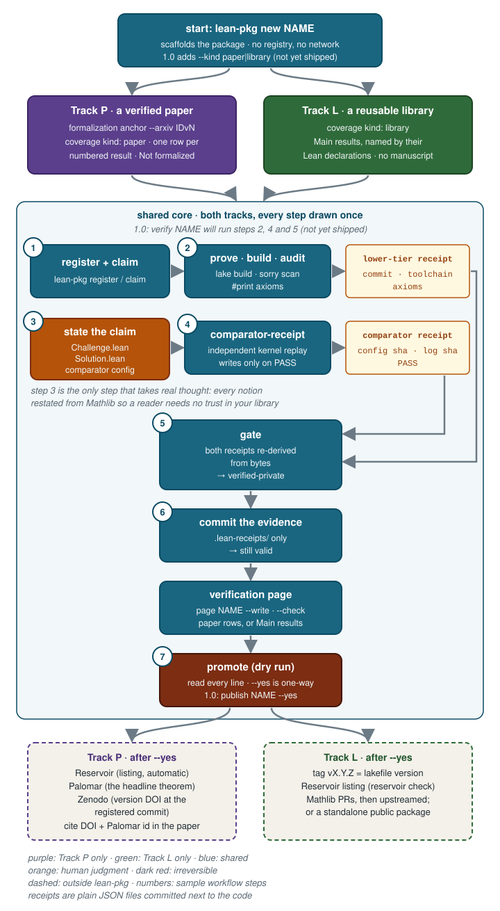

[← lean-pkg documentation](index.md)



A real session, start to finish, on a real package. The package is small on
purpose: a consumer of Scott Armstrong's
[MarkovProcess](https://github.com/scottnarmstrong/MarkovProcess) library
that proves two theorems about Brownian motion. Everything below was run on
2026-10-05; outputs are lightly shortened.

## 0. The package

```
MarkovProcessPilot/
  lean-toolchain                 leanprover/lean4:v4.35.0-rc2
  lakefile.toml                  one require: MarkovProcess @ 666cda02…
  lake-manifest.json             tracked; Mathlib arrives transitively
  LICENSE                        Apache-2.0
  MarkovProcessPilot.lean
  MarkovProcessPilot/BrownianExit.lean
```

The theorems it proves, in `BrownianExit.lean`:

```lean
/-- The library's Brownian motion is Brownian in Mathlib's sense. -/
theorem isBrownianReal_brownianMotion (x : ℝ) :
    ProbabilityTheory.IsBrownianReal
      (fun (t : ℝ≥0) (ω : MarkovProcess.ContinuousPath ℝ) ↦ ω t - x)
      (MarkovProcess.brownianMotion x)

/-- Brownian motion started at `x ∈ (a, b)`, stopped at its exit time from
`(a, b)` truncated at `K`, has mean `x`. -/
theorem integral_eval_exitTimeTrunc_Ioo (a b x : ℝ) (hax : a < x) (hxb : x < b) (K : ℝ≥0) :
    ∫ ω, ω (MarkovProcess.ContinuousPath.exitTimeTrunc (Set.Ioo a b) K ω)
      ∂(MarkovProcess.brownianMotion x) = x
```

Build cost: the library builds from source in 3 m 33 s and 1.5 GB; the
package itself in 7 s.

## 1. Register and claim

```bash
export LEAN_PKG_REGISTRY=~/lean-registry/lean-packages.yaml   # bootstrap: printf 'version: 1\npackages: {}\n' > that file

lean-pkg register markovprocess-pilot \
    --repo git@github.com:you/markovprocess-pilot.git \
    --path src/markovprocess-pilot --owner-project rmt-foundations
# markovprocess-pilot: registered (status=active, visibility=private, toolchain=leanprover/lean4:v4.35.0-rc2, pin=065356127b)

lean-pkg claim markovprocess-pilot --workspace laptop --agent you --reason "exit-time optional stopping"
```

The registry now knows the package exists, who holds it, and its pins. It
knows nothing about correctness yet.

## 2. Prove, build, audit

```bash
cd ~/src/markovprocess-pilot
lake exe cache get && lake build
# Build completed successfully (3427 jobs).

grep -rnE '\bsorry\b|^axiom ' --include='*.lean' . | grep -v .lake     # empty
lake env lean scripts/Axioms.lean
# 'MarkovProcessPilot.integral_eval_exitTimeTrunc_Ioo' depends on axioms: [propext, Classical.choice, Quot.sound]
```

Freeze that output as a report, hash it, and write the lower-tier receipt
(the tool validates it; your executor, be it a workstation, a Slurm job, or
CI, produces it):

```json
{ "commit": "<HEAD>", "lean_toolchain": "leanprover/lean4:v4.35.0-rc2",
  "mathlib_rev": "065356127b1dc0016f66b7283ce0ce2c4055aa55", "sorry_count": 0,
  "axioms": ["propext", "Quot.sound", "Classical.choice"],
  "report_sha256": "<sha256 of the report>", "job_id": "laptop-2026-10-05-1",
  "checker": "lake build + sorry scan + #print axioms", "generated_at": "2026-10-05T18:00:00+00:00" }
```

```bash
lean-pkg update markovprocess-pilot --status gate-pending --reason "lower-tier check done"
```

## 3. State the claim for a second kernel

Create the comparator layout: a trusted statement module, an untrusted
proof module, and a configuration. The statement module imports Mathlib
only and restates the theorem with `sorry`; the solution module proves it
by delegating to the library.

```
Challenge.lean      theorem exit_mean … := by sorry        (statements only, Mathlib imports only)
Solution.lean       theorem exit_mean … := MarkovProcessPilot.integral_eval_exitTimeTrunc_Ioo …
comparator/config-exit.json
```

```json
{ "challenge_module": "Challenge", "solution_module": "Solution",
  "theorem_names": ["exit_mean"], "definition_names": [],
  "permitted_axioms": ["propext", "Quot.sound", "Classical.choice"], "enable_nanoda": true }
```

Writing the Challenge is the intellectual step: every notion in the
statement must be built from Mathlib primitives so that a reader can check
the claim without trusting your library. Commit it.

## 4. Run the comparator and write its receipt

On an allowed host (a Slurm job, or a host you list):

```bash
git status --short                      # must be empty
COMPARATOR_RECEIPT_ALLOWED_HOSTS="$(hostname)" comparator-receipt
# == comparator @ 5756749…   == lean4export @ …   == nanoda_lib @ …   == landrun @ …
# Running nanoda kernel on solution
# nanoda kernel accepts the solution
# Your solution is okay!
# PASS comparator/config-exit.json
# comparator receipt written: .../.lean-receipts/<c12>-comparator.json (1 config(s), commit <c12>, host policy: host laptop listed in COMPARATOR_RECEIPT_ALLOWED_HOSTS)
```

The runner wrote nothing until every configuration passed. Check the
receipt before recording it:

```bash
lean-pkg comparator markovprocess-pilot --check --receipt .lean-receipts/<c12>-comparator.json
# markovprocess-pilot: comparator receipt valid at commit <c12> (1 config(s)) — not recorded (--check)
```

## 5. Gate, then commit the evidence

```bash
lean-pkg gate markovprocess-pilot --receipt receipt.json --comparator .lean-receipts/<c12>-comparator.json
# receipt copied to …/.lean-receipts/<c12>-laptop-2026-10-05-1.json — NOT committed there; commit it in the verified repo yourself
# markovprocess-pilot: gate-pending -> verified-private (commit <c12>) with comparator evidence .lean-receipts/<c12>-comparator.json

git add .lean-receipts && git commit -m "evidence: receipts for <c12>"
```

That commit touches only `.lean-receipts/`, so HEAD is an evidence-only
descendant of the certified commit and both receipts stay valid.

## 6. Promotion dry run

```bash
lean-pkg promote markovprocess-pilot
#   ✓  LICENSE/COPYING present at repo root
#   ✓  lake-manifest.json tracked at HEAD
#   ✓  gate receipt bound to HEAD <h12> (evidence-only descendant of <c12> (+3 evidence file(s)))
#   ✓  comparator PASS bound to HEAD <h12> (1 config(s), nanoda replay)
#   ✓  gh visibility matches registry (private)
#   ✓  automation disclosure not required (upstream_target=none)
# WARNING: a GitHub private→public flip is effectively ONE-WAY — …
# DRY RUN — nothing changed. Re-run with --yes to execute.
```

Read every line. `--yes` is the only one-way step in the whole workflow.

## 7. After `--yes`

Publication is the ecosystem's job, not the tool's: list on
[Reservoir](https://reservoir.lean-lang.org/) (automatic for a public
repository with a license and two stars), register a headline-theorem
package in [Palomar](https://palomar-registry.org/) through its submission
form, cut a GitHub release at the registered commit and mint its Zenodo
DOI, and cite the DOI and the Palomar id in the paper. Then
`lean-pkg release markovprocess-pilot --agent you`.

What took real thought in this session: step 3. Steps 1, 2, 4, 5, and 6 are
mechanical, and an agent can run them from [llms.txt](llms.txt).
